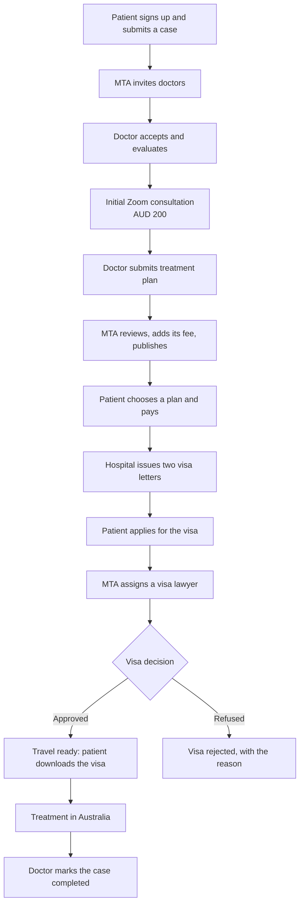

# End-to-end journey

One patient, one case, five portals. Setup and accounts are in the [demo guide](README.md).

## Who does what

| # | Stage | Who acts | Case status |
|---|---|---|---|
| 1 | Sign up, verify email, complete profile | Patient | |
| 2 | Submit case with reports | Patient | Case submitted |
| 3 | Invite doctors | MTA | Under review |
| 4 | Accept the invitation | Doctor | Doctor assigned |
| 5 | Review the case, request documents if needed | Doctor, patient | Evaluation |
| 6 | Propose times, patient picks one and pays, Zoom call | Doctor, patient | Evaluation |
| 7 | Write and submit the treatment plan | Doctor | Evaluation |
| 8 | Review the plan, set the service fee, publish | MTA | Treatment plan |
| 9 | Compare plans and choose one | Patient | Treatment confirmed |
| 10 | Pay for treatment | Patient | Payment confirmed |
| 11 | Generate and send both visa letters | Hospital | Payment confirmed |
| 12 | Complete the visa application | Patient | Visa documents submitted |
| 13 | Assign a lawyer | MTA | Visa documents submitted |
| 14 | Review, request documents, lodge | Lawyer | Visa processing |
| 15 | Record the decision, upload the visa | Lawyer | Travel ready (or Visa rejected) |
| 16 | Treatment, then mark as completed | Doctor | Completed |

MTA can close a case at any stage.

## 20-minute demo: the highlights

Uses the demo data as it stands, so nothing has to be set up. Sign in to each role in its own window beforehand.

| Time | Portal | Show | Key message |
|---|---|---|---|
| 2 min | Intro | The table at the top of the [demo guide](README.md) | One case, five roles |
| 4 min | Patient | Dashboard journey, a case page, treatment options, payment history and an invoice | The patient always knows the next step |
| 4 min | Doctor | The dashboard, then the invitation on My Cases | Real figures showing the value of membership |
| 3 min | Admin | Dashboard, one doctor approval with register checks | MTA controls quality and sees everything |
| 3 min | Hospital | Documents: generate and send a letter | Visa letters in two clicks |
| 3 min | Lawyer | The new case, moving it to Under Review | Only assigned cases are visible |
| 1 min | Mailbox | http://localhost:8025 | Everyone is kept informed automatically |

## 45-minute demo: one case, start to finish

Takes the seeded knee replacement case, already in evaluation with Dr. Chen, all the way through.

1. **Doctor:** open the knee case on My Cases. Under **Initial Zoom Consultation**, propose a time.
2. **Dev box:** click *Choose the first time and pay (patient)*, then *Fast-forward: the consultation has taken place*.
3. **Doctor:** **Build Treatment Plan**. Add a diagnosis, procedure, dates, hospital and costs, then submit.
4. **Admin:** Treatment Plans → open it → **Approve and send to patient**.
5. **Patient:** open the case's treatment options, choose the plan, **Pay Now**. Show the invoice.
6. **Hospital:** Documents → generate and send both letters.
7. **Patient:** Visa & Travel → complete the application. Upload any small PDF or photo for the documents.
8. **Admin:** Visa Cases → assign James Whitfield.
9. **Lawyer:** open the case → **Update Status** to Under Review, request a document, then Processing, then Approved. Upload the visa under Documents.
10. **Patient:** download the approved visa.
11. **Mailbox:** show the trail of messages.

Have a small PDF ready for the uploads. Step 10 ends at Travel Ready: **Mark as Completed** only unlocks after the plan's end date, so show that on one of Dr. Chen's history cases, or use **Mark completed** in the admin portal.
