# Visa lawyer portal: screen flow

Migration agents and lawyers review and progress the visa applications MTA assigns to them. Shown as `lawyer@demo.local` (James Whitfield), plus a new sign-up and `pending.lawyer@demo.local` for the joining screens. For the fee screen the lawyer fees were set to AUD 400 (registration) and AUD 250 (annual); in the demo they start at $0. English only.

Screens appear in the order a user meets them. Captured from the local dev environment with demo data at 1440 × 900 (full page). Developer-only test buttons are hidden; payment screens still say that payments are simulated. Regenerate with `e2e/screen-flows.mjs` (see [README](README.md)).

## Contents

**Joining**

1. [Lawyer sign-up](#1-lawyer-sign-up)
2. [Registration wizard](#2-registration-wizard)
3. [Waiting for approval](#3-waiting-for-approval)
4. [Registration fee](#4-registration-fee)

**Everyday screens**

5. [Dashboard](#5-dashboard)
6. [Visa cases](#6-visa-cases)
7. [Visa case details](#7-visa-case-details)
8. [Documents](#8-documents)

**Support and account**

9. [Messages](#9-messages)
10. [Notifications](#10-notifications)
11. [Account & Settings: Profile](#11-account-settings-profile)
12. [Account & Settings: Billing](#12-account-settings-billing)
13. [Account & Settings: Security](#13-account-settings-security)
14. [Account & Settings: Notifications](#14-account-settings-notifications)

## Joining

### 1. Lawyer sign-up

`/register/lawyer`: Email, password and the terms.

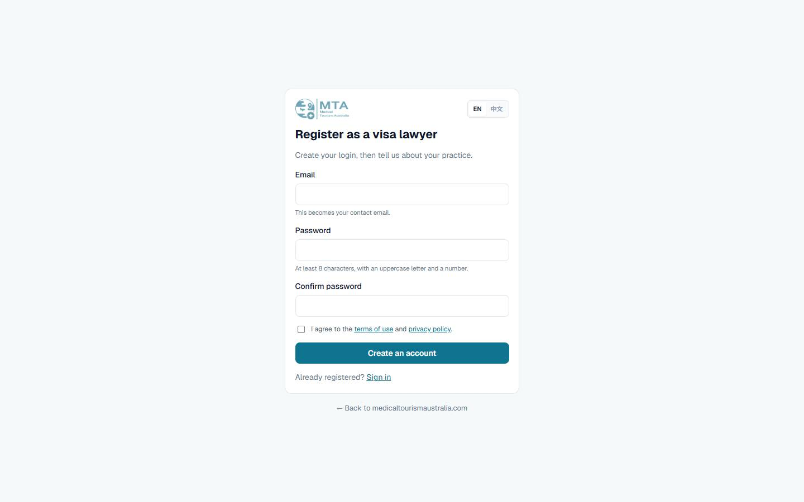

### 2. Registration wizard

`/lawyer/register`: Practice details and a MARN or practising certificate.

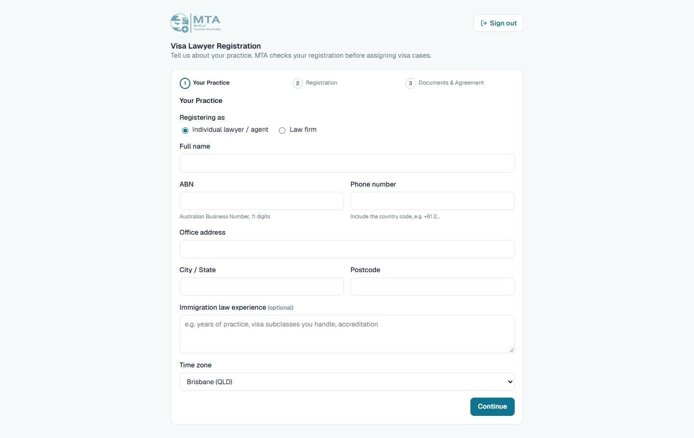

### 3. Waiting for approval

`/lawyer/pending-approval`: MTA checks the register and approves, rejects or asks for more information.

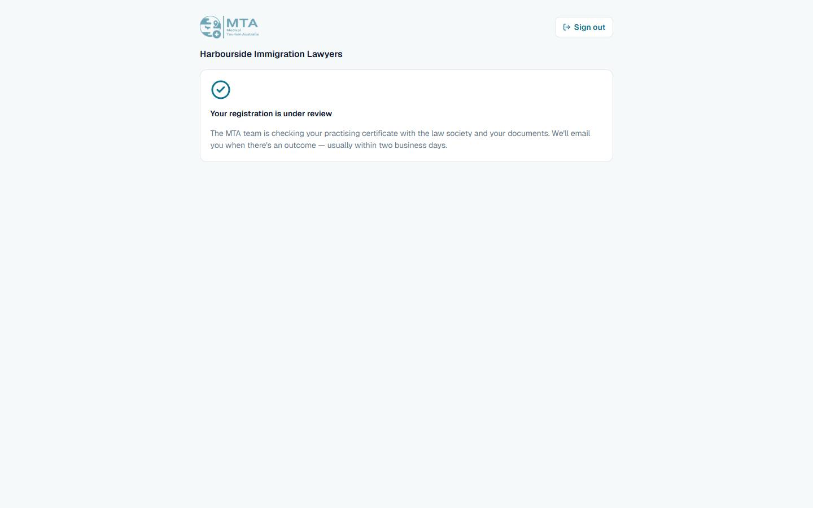

### 4. Registration fee

`/lawyer/registration-fee`: Only when MTA has set a registration fee above $0: the portal opens, and cases can be assigned, once it is paid.

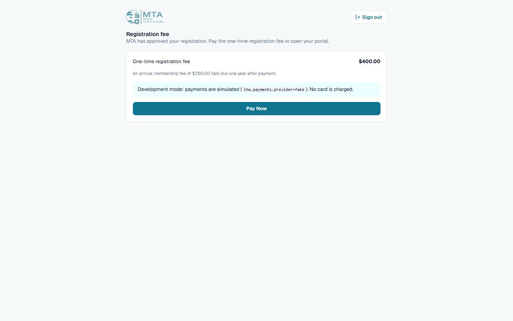

## Everyday screens

### 5. Dashboard

`/lawyer/dashboard`: Assigned applications and what needs doing.

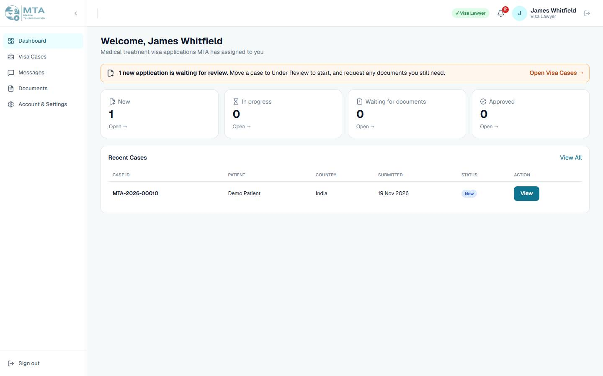

### 6. Visa cases

`/lawyer/cases`: Applications assigned to the lawyer, by status.

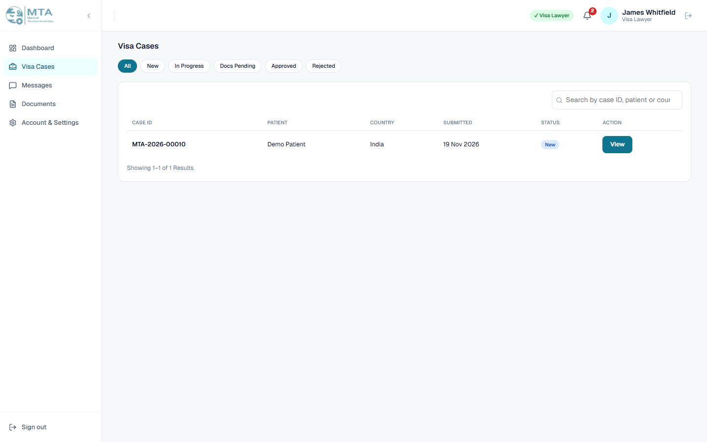

### 7. Visa case details

`/lawyer/cases/{id}`: The application and its documents, notes, and the status workflow up to issuing the visa grant.

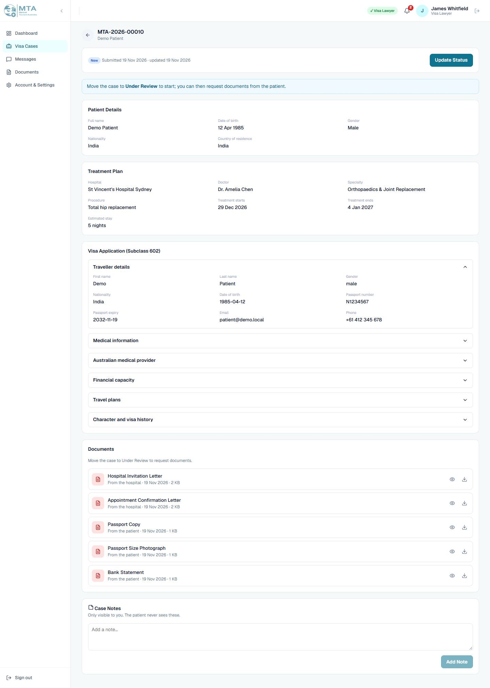

### 8. Documents

`/lawyer/documents`: Every document across the lawyer’s cases.

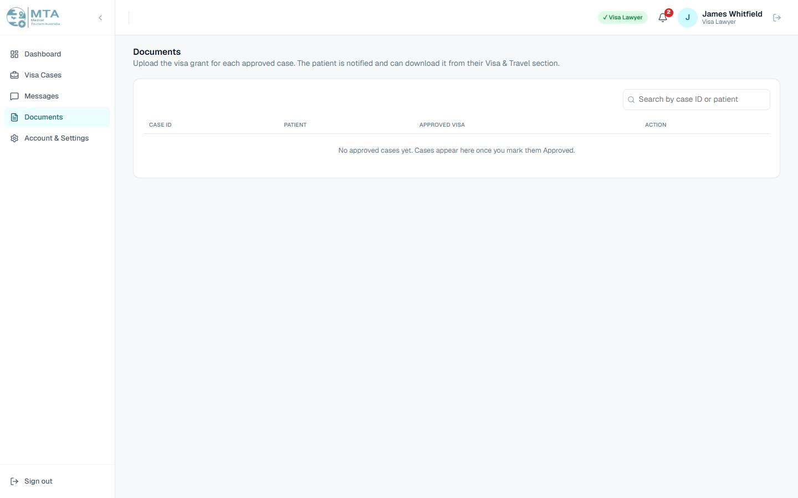

## Support and account

### 9. Messages

`/lawyer/messages`: Chat with MTA.

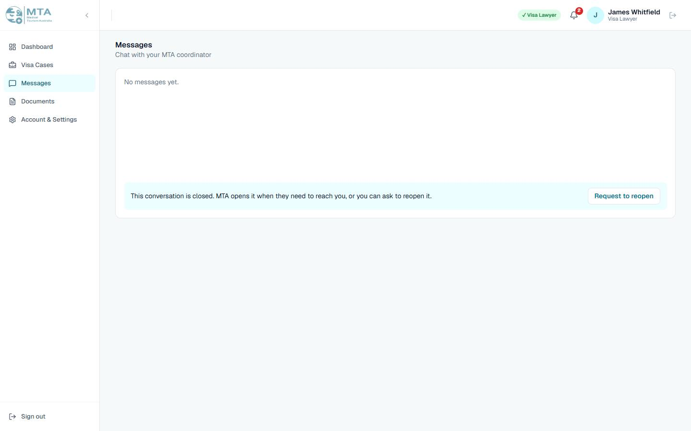

### 10. Notifications

`/lawyer/notifications`: New assignments and fee reminders.

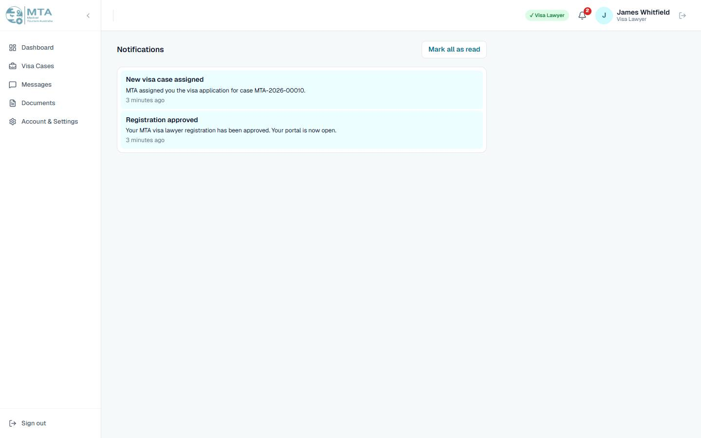

### 11. Account & Settings: Profile

`/lawyer/account-settings?tab=profile`: Practice details and time zone.

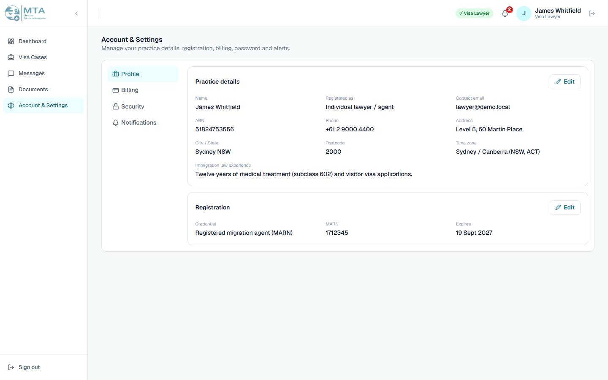

### 12. Account & Settings: Billing

`/lawyer/account-settings?tab=billing`: Registration and annual membership fees, with invoices.

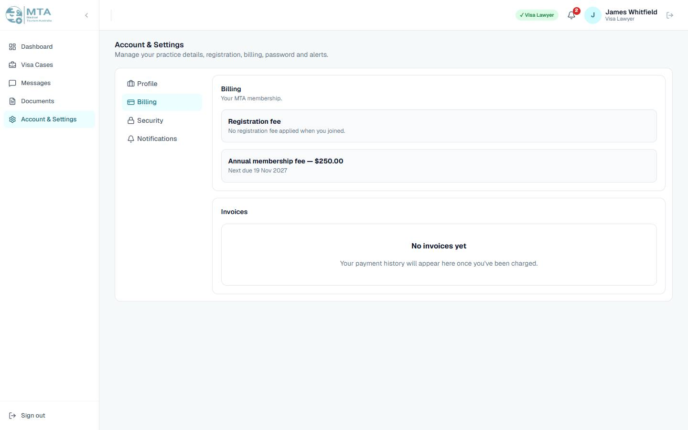

### 13. Account & Settings: Security

`/lawyer/account-settings?tab=security`: Change password.

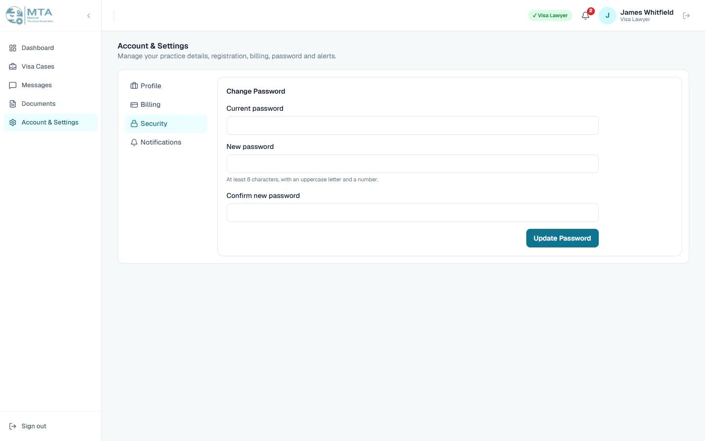

### 14. Account & Settings: Notifications

`/lawyer/account-settings?tab=notifications`: Email and SMS preferences.

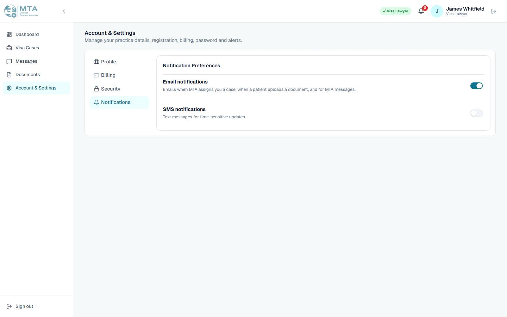
