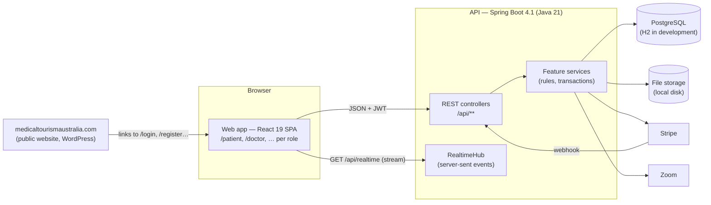
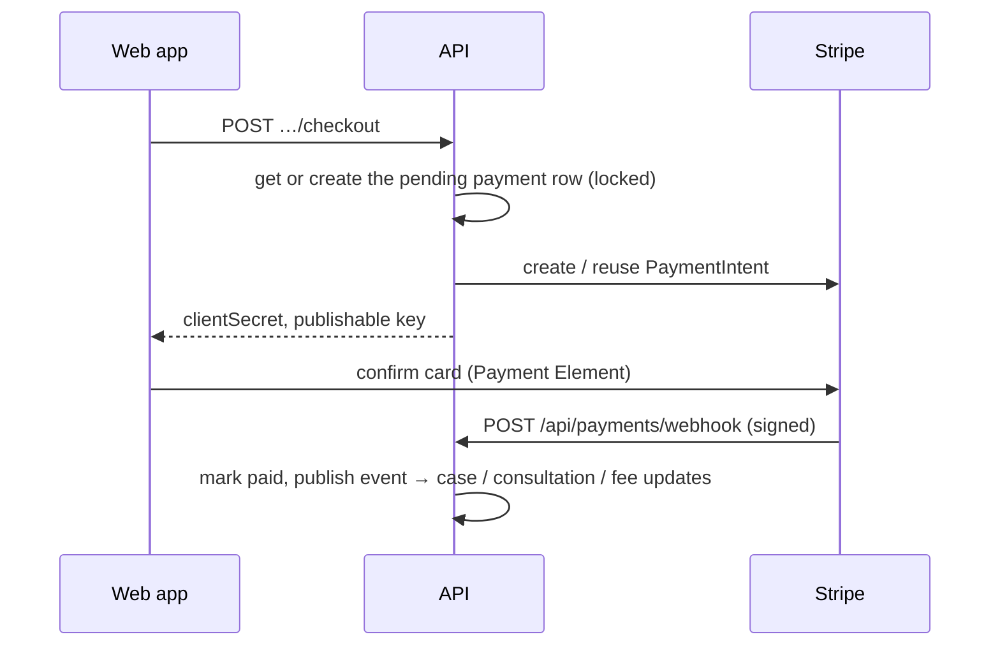

# Architecture

## Overview



- **One API** (`backend/`) serves every role. It owns all business rules, permissions and data access.
- **One web app** (`frontend/`) has a route tree per role (`/patient/**`, `/doctor/**`, …). Users sign in on the same page and are sent to their own area.
- **The public website** is the home page; the portal has no landing page of its own.

## Roles

Every account has exactly one role, stored on `app_users.role` and copied into the access token:

| Role | Area | State |
|---|---|---|
| `PATIENT` | `/patient` | Ported |
| `DOCTOR` | `/doctor` | Ported |
| `HOSPITAL` | `/hospital` | Placeholder |
| `LAWYER` | `/lawyer` | Placeholder |
| `ADMIN` | `/admin` | Started (core coordinator workflow) |

## Authentication

1. **Sign-up** creates an `app_users` row (BCrypt password hash) and emails a 6-digit code (`email_verification_codes`, 15-minute expiry, 5 attempts).
2. **Verify** (`POST /api/auth/verify`) or **login** (`POST /api/auth/login`) returns an **access token**: an HS256-signed JWT with `sub` (user id), `email` and `role` claims, valid 8 hours.
3. The web app stores the session in `localStorage` and sends `Authorization: Bearer <token>` on every call. A 401 signs the user out.
4. Password reset uses the same code mechanism with purpose `reset_password`.

## Authorization

Two layers, both in the API:

1. **By role, per URL prefix** (`config/SecurityConfig`): `/api/patient/**` needs `PATIENT`, `/api/doctor/**` needs `DOCTOR`, and so on. `/api/auth/**`, `GET /api/specialties` and the payment webhook are public.
2. **By ownership, in services.** Every query starts from the caller's own row (`PatientService.requireCurrent`, `DoctorAccountService.requireActive`) and looks records up through it (a patient's cases; a doctor's assigned cases). Someone else's record is answered with **404**, never 403, so ids can't be probed.

This replaces the old app's Postgres row-level security.

## Request flow

```
Browser → Controller (validates request record, maps response record)
        → Service   (@Transactional: permission + business rules, entity changes)
        → Repository (Spring Data JPA) → database
        → events (notifications, realtime pushes, cross-module reactions)
```

Errors are thrown as `ApiException` (HTTP status + stable `code` + user-safe message) or `FieldValidationException` (per-field messages) and rendered as RFC 9457 problem details:

```json
{ "status": 409, "code": "invalid_transition", "detail": "This case is no longer in the right stage for that action." }
```

## Events between modules

Modules don't call each other in circles; they publish Spring application events:

| Event | Published by | Handled by |
|---|---|---|
| `PatientRegisteredEvent` | patient sign-up | chat (creates the support thread) |
| `EmailVerifiedEvent` | auth | patient (welcome notification) |
| `TreatmentOptionSelectedEvent` | patient picks an option | payment (creates the pending payment) |
| `ConsultationSlotSelectedEvent` | patient picks a time | payment (creates the consultation fee payment) |
| `PaymentCompletedEvent` | payment webhook | treatment (confirms the plan, moves the case), consultation (schedules + Zoom) |
| `UnmatchedIntentEvent` | payment webhook, for intents that aren't patient payments | doctor fees (registration / annual fee) |
| `CaseDocumentsAddedEvent` | patient adds case documents | doctor (marks document requests received) |
| `RealtimeEvent` | many | realtime hub (pushed to the browser after commit) |

## Notifications and alerts

`NotificationService` writes an in-portal notification row and, when asked, an **alert** (email/SMS) according to the user's preferences (`AlertPreferences`, implemented by the patient and doctor modules). Alerts are sent after the transaction commits. Delivery is not wired yet: `AlertDispatcher` logs `[email → …]` and `[sms → …]`.

Notification titles and messages are copied word for word from the old database triggers — the patient's case timeline matches on them.

## Live updates

`GET /api/realtime` is a server-sent-events stream per signed-in tab (`RealtimeHub`, in memory). The browser reads it with `fetch` so it can send the bearer token, reconnects with backoff, and closes it when the page is hidden (browsers allow only ~6 connections per host).

Event types: `notification`, `chat_message` (patient chat), `provider_message` (provider chat).

The hub is single-instance. Running several API instances needs a broker (Redis, Postgres `LISTEN/NOTIFY`, …) behind it.

## Payments



- `PaymentGateway` has two implementations: **Stripe** (production) and **Fake** (development default: the payment page shows a "Pay Now" button that runs exactly the same completion code as the webhook).
- Patient payments: treatment (`full_payment`) and consultation fee. Doctor payments: registration fee and annual renewal. All fee amounts are admin-configurable (`platform_fee_settings`, read through `FeeSettingsService` when a charge is created).
- PDF invoices are drawn with PDFBox.

## Files

`StorageService` stores uploads under relative keys (`case-documents/<patientId>/<caseId>/<file>`, `visa-documents/…`, `registration-documents/…`, `avatars/…`). The current implementation is the local disk (`IHA_STORAGE_ROOT`); swap it for S3-style storage without touching callers.

Every upload goes through `Uploads.validate`, which checks the size and **detects the type from the file's bytes** (PDF, JPEG, PNG, WebP). Files are always streamed through the API after an ownership check — storage paths are never exposed.

## Sensitive data

Personal and clinical fields live in `*_enc` columns, encrypted with AES-256-GCM by JPA converters (`crypto/`): dates of birth, passports, licence numbers, medical history, treatment plan details, costs. The key is `IHA_PII_KEY`; changing it makes existing rows unreadable. Audit entries (`audit_logs`) record who did what, never the sensitive values.

## Scheduled jobs

| Job | Schedule | Does |
|---|---|---|
| `PatientRetentionJob` | daily 03:30 | Hard-deletes patient accounts whose 30-day deletion grace period has passed, including their files. |

## How the old design maps onto the new one

| Supabase / Next.js | Spring / React |
|---|---|
| Supabase Auth | `app_users`, BCrypt, 6-digit codes, HS256 JWTs |
| Five Next.js apps | One SPA with a route tree per role |
| Row-level security | Role per URL prefix + ownership checks in services |
| pgcrypto `*_enc` columns | AES-256-GCM JPA converters |
| SQL RPCs and triggers | Service methods and events |
| Supabase Storage | `StorageService` + authenticated download endpoints |
| Supabase Realtime | Server-sent events (`/api/realtime`) |
| next-intl | Same `en.json` / `zh.json` with a small translator |
| Edge function for account deletion | `PatientRetentionJob` |
| 137 migrations | `V1`–`V4` Flyway migrations (final schema shape) |
