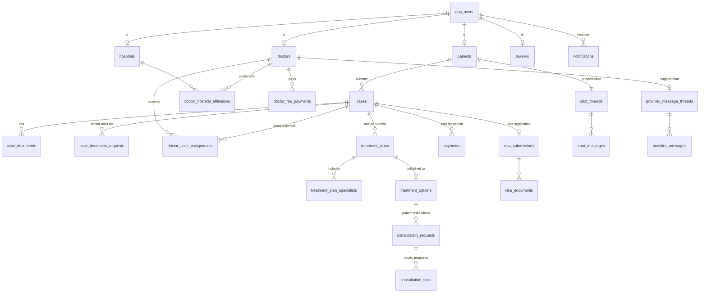
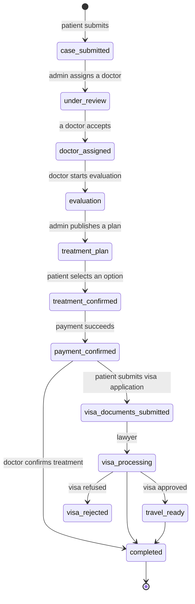

# Data model

Schema: `backend/src/main/resources/db/migration/` — `V1__core_schema.sql` (all core tables), `V2__seed_reference_data.sql` (specialties, platform fees), `V3__patient_portal.sql`, `V4__doctor_portal.sql`, `V5__initial_consultation.sql`. Columns ending in `_enc` are AES-GCM encrypted by the API.

## Entity overview

## Tables

| Table | Purpose |
|---|---|
| `app_users` | Every login: email, BCrypt hash, role, verified flag. |
| `email_verification_codes` | 6-digit codes for email verification and password reset (hashed, expiring, attempt-limited). |
| `specialties` | Medical specialties (English/Chinese labels, sort order). |
| `platform_fee_settings` | `doctor_registration_fee` (AUD 5,000) and `doctor_annual_fee` (AUD 2,000). |
| `patients` | Patient profile: personal details, encrypted DOB and medical background, emergency contact, avatar, alert preferences, Stripe customer, deletion schedule. |
| `doctors` | Doctor profile: registration details, encrypted DOB and licence, specialties, languages, working days, availability (JSON), registration documents (JSON), approval status, fee dates, alert preferences. |
| `doctor_hospital_affiliations` | Hospitals a doctor works with (plan hospitals come from here). |
| `hospitals`, `lawyers` | Provider accounts (portals not ported yet). |
| `cases` | A patient's medical case: reference `MTA-<year>-<seq>`, specialty, description, status, travel-assistance flags. |
| `case_documents` | Medical documents (and standalone uploads not yet linked to a case). |
| `case_document_requests` | Documents a doctor requested during evaluation; `pending` until the patient adds one of that type, then `received`. |
| `doctor_case_assignments` | Admin's invitation of a doctor to a case and the doctor's progress on it. |
| `treatment_plans` | One per doctor per case; clinical and cost fields encrypted. |
| `treatment_plan_specialists` | Extra specialists and their fees on a plan. |
| `treatment_options` | A plan as offered to the patient, with MTA's commission; `selected` when chosen. |
| `consultation_requests`, `consultation_slots` | Paid online consultations and the proposed times. |
| `payments`, `payment_methods` | Patient payments (treatment, consultation fee) and saved cards. |
| `doctor_fee_payments` | Doctor registration and annual fees. |
| `visa_submissions`, `visa_documents`, `visa_document_requests`, `visa_case_notes` | Visa application, its documents (patient, hospital letters, approved visa), lawyer requests and notes. |
| `chat_threads`, `chat_messages` | Patient ↔ coordinator chat. |
| `provider_message_threads`, `provider_messages` | Doctor/hospital/lawyer ↔ admin chat (one thread per provider account). |
| `notifications` | In-portal notifications (title, message, type, case). |
| `audit_logs` | Who did what, when (no sensitive values). |

## Case lifecycle

`closed` is an administrative end state. Every change goes through `CaseStatusService.transition`, which also writes the patient's timeline notification. The lawyer transitions (`visa_processing`, `travel_ready`, `visa_rejected`) arrive with the lawyer portal.

## Doctor assignment lifecycle

| Status | Meaning |
|---|---|
| `invited` | Admin invited the doctor (doctor sees "New"). |
| `accepted` | Doctor accepted; `evaluation_started_at` and `plan_submitted_at` record their own progress. |
| `declined` | Doctor declined (optional reason for admin). |
| `withdrawn` | Doctor withdrew after accepting. |
| `cancelled` | Closed by the system, e.g. another doctor's plan was chosen ("Case Closed"). |

Several doctors can be invited to the same case; each evaluates and proposes a plan independently.

## Treatment plan lifecycle

`draft` → `submitted_to_iha` (doctor submits) → `iha_review_in_progress` / `iha_approved` / `rejected_by_iha` (admin) → `presented_to_patient` (published as an option) → `patient_confirmed` (chosen and paid) or `not_selected`. A declined plan keeps admin's reason in `rejection_reason` (V6).
Only drafts are editable.

## Consultation lifecycle

Two kinds share one table (`consultation_requests.kind`):

- **initial** — before the plan. The doctor creates it during evaluation with proposed times (starts at `slots_proposed`); `doctor_id` is set, there's no treatment option. A doctor's plan can only be submitted once it has taken place (scheduled and its start time passed) or the doctor recorded a skip reason (`doctor_case_assignments.consultation_skipped_reason`).
- **option** — after the plan. The patient asks about a published treatment option (`treatment_option_id`).

`requested` (patient) → `slots_proposed` (doctor, 1–3 times; can be updated) → `slot_selected` (patient picks; AUD 200 fee due) → `scheduled` (paid; Zoom meeting created). The doctor can cancel at any point before `scheduled`. "Completed" in the doctor UI is a scheduled consultation whose time has passed.

## Doctor account lifecycle

`pending` (registered) → `approved` / `rejected` / `more_info_requested` (admin). Rejected and more-info doctors can resubmit (back to `pending`). An approved doctor pays the registration fee (`registration_fee_paid_at`), which unlocks the portal and sets `annual_fee_next_due_at` one year later; each annual payment moves it on by a year.

## Payments

| Table | `payment_type` / `fee_type` | Created when | Completed by |
|---|---|---|---|
| `payments` | `full_payment` | patient selects an option | webhook → plan `patient_confirmed`, case `payment_confirmed` |
| `payments` | `consultation_fee` | patient selects a slot | webhook → consultation `scheduled` (+ Zoom) |
| `doctor_fee_payments` | `registration` / `annual` | doctor starts checkout | webhook → doctor fee dates |

Status: `pending` → `completed` or `failed`. At most one pending row per purpose (locked get-or-create).
