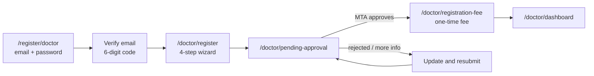
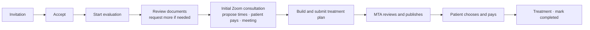

# Doctor portal

Area: `/doctor/**` · Code: `frontend/src/portals/doctor/`, backend packages `doctor`, `provider`, `providerchat` · Language: English · Times: Brisbane (AEST, no daylight saving).

The screens follow the live dev doctor portal (https://dev.doctor.medicaltourismaustralia.com).

## Navigation

Dashboard · My Cases · Consultations · Messages · Account & Settings — plus the notification bell, the doctor's photo/name ("Doctor") and sign-out in the top bar.

## Getting access

1. **Sign-up** (`/register/doctor`, linked from the login page): email and password, then the emailed code.
2. **Registration wizard**:
   - *Basic Information* — full name, phone, optional profile photo.
   - *Professional Details* — specialties, qualifications, years of experience, AHPRA number (3 letters + 10 digits), languages, bio.
   - *Hospital & Availability* — department, role (consultant/surgeon), hospital affiliations, working days.
   - *Documents* — medical license and degree certificate (required), other certificates. Shows the registration and annual fees.
3. **Pending approval** — MTA reviews the registration. If MTA rejects it or asks for more information, the doctor sees the message and can update and resubmit (earlier documents are kept unless replaced).
4. **Registration fee** — once approved, the one-time fee (AUD 5,000 by default) unlocks the portal. The annual renewal (AUD 2,000) falls due a year later.

Until the doctor is approved and has paid, every portal page redirects to the right gate step, and the API refuses portal calls.

## Dashboard
Laid out after the *MTA Doctor Dashboard Concept*. Every figure is computed from real records by `GET /api/doctor/insights`; cross-doctor figures are anonymised aggregates.

| Area | Shows |
|---|---|
| Welcome line | Membership renewal date, "Last 12 months". Top bar: *Verified Doctor* badge for approved doctors. |
| Hero banner | **Return on membership**: doctor fees on plans patients paid for in the last 12 months, and that as a multiple of the fees paid to MTA. Patients treated, rank in the main specialty (top % by treated patients among active doctors in it; shown with 3+ doctors), fees awaiting treatment. |
| Stat cards | Cases received (vs the previous quarter), plan acceptance rate (vs platform average), average response time to invitations (target ≤ 48 h), patient rating (*Soon*), profile strength (share of profile fields completed). |
| Action needed today | New invitations with time left on the 48-hour target, plans due, consultation requests needing times, consultations in the next 7 days (*Add to calendar* downloads an .ics file), documents patients uploaded this week, plans MTA declined, cases ready to mark completed. |
| Conversion funnel | Assigned → Accepted → Consulted → Plan sent → Chosen by patient → Treated. |
| Why cases didn't proceed | Chose another doctor, plan declined by MTA, visa rejected, cases you declined; plus a pricing insight when your prices differ ≥ 10% from the platform. |
| Price benchmark | Your median whole-plan total per specialty vs the median of other doctors' plans (only when 2+ other doctors have plans, so no individual price can be inferred). |
| Earnings | This year / awaiting treatment / treated, and a 9-month bar chart by payment month. Payouts *Soon*. |
| Membership & growth | Annual membership renewal and fees paid (link to Billing), refer a colleague (*Soon*), verification badges: AHPRA licence and qualifications (verified on approval), indemnity insurance (not collected yet). |
| Feature cards (*Soon*) | Patient follow-ups, hospital packages, plan templates, public profile. |

## My Cases
Tabs **All · New · Evaluation · Treatment Plan Submitted · Plan Confirmed · Completed · Declined**, search by patient or case ID, date filter (All Time / 7 / 30 / 90 days), 15 rows per page.

Status badges, from the doctor's point of view:

| Badge | When |
|---|---|
| New | Invitation not answered yet |
| Accepted | Accepted, evaluation not started |
| Evaluation | Evaluating |
| Treatment Plan Submitted | This doctor's plan is with MTA |
| Awaiting Patient | Options published; the patient is choosing |
| Treatment Confirmed / Payment Confirmed | The patient chose and paid |
| Visa Documents Submitted / Visa Processing / Travel Ready / Visa Rejected | Visa stage |
| Completed | Treatment done |
| Declined | The doctor declined, or MTA rejected the plan |
| Withdrawn / Case Closed | Withdrawn by the doctor / closed because another plan was chosen |

## How a case flows

**The initial Zoom consultation is required before the plan.** During evaluation the doctor offers up to three times (Brisbane time); the patient picks one and pays the AUD 200 consultation fee; the Zoom meeting is created on payment. *Submit Plan* stays locked until the consultation's time has come. When a consultation really isn't needed (e.g. they already spoke), the doctor can skip it with a reason MTA can see. Drafting the plan is allowed at any time.

The patient can still ask for a **follow-up consultation** about a published plan before choosing; it works the same way and doesn't block anything.

## Case details
- Case ID and status; **Patient Info** (name, condition, date of birth, gender, country); **Case Summary** (condition, symptoms); **Medical History** (history, allergies, medications, past surgeries).
- **Uploaded Documents** — view or download each file.
- **Initial Zoom Consultation** card (once evaluation has started): propose times, then follow it — waiting for the patient, awaiting payment, booked (with *Join Zoom*), held — or *Skip with a reason*.
- **Request More Documents** (during evaluation) — tick document types and add a message; the patient is notified by portal, email and SMS. **Document Requests** then lists each request as *Pending* until the patient uploads that type, then *Received* with the date.
- **Actions**, depending on the stage:
  - *Accept* / *Decline* (optional reason) an invitation.
  - *Start Evaluation* (moves the case to evaluation).
  - *Build Treatment Plan*, or *Treatment Plan Sent — View* after submitting.
  - *View Treatment Plan* later on.
  - *Mark as Completed* once the patient has paid and the plan's end date has passed (asks for confirmation; notifies the patient).
- Links to any consultation requests on this case.

## Treatment plan builder
Collapsible sections:

| Section | Fields |
|---|---|
| Diagnosis | Primary diagnosis* |
| Treatment / Procedure | Treatment type* (medication only / surgery / therapy), procedure*, description, technique, success rate, expected outcome |
| Timeline & Recovery | Start* and end* dates (duration calculated), recovery time, estimated hospital stay* |
| Hospital Information | Hospital* (from affiliations), department, room category (the hospital's room types), special requirements |
| Cost Estimation | Doctor fees*, hospital fees, itemised costs (quick-add Surgery Charge, Diagnostics & Lab, Anaesthesia Charges, Medication Estimate, Rehabilitation Charges, or a custom item), notes |
| Specialists | Role, name, fee, notes |
| Doctor Notes | Instructions for the patient, aftercare (one per line) |

Until the initial consultation is held (or skipped), a banner explains why *Submit Plan* is locked and links to the consultation. A sticky **Estimated Total** sums doctor fees, hospital fees, itemised costs and specialists (MTA's commission is added later by admin). *Save Draft* keeps partial work (and unsaved typing survives a page refresh); *Submit Plan* needs the confirmation tick and the required fields (*) and notifies the chosen hospital. Submitted plans are read-only, with a banner explaining their state.

## Consultations
Tabs **All · Awaiting Slots · Awaiting Patient Confirmation · Scheduled · Completed · Cancelled**, search, paging.

Initial consultations show as "Initial consultation" in the list; follow-ups show the plan's procedure. On a consultation:
- **Propose Consultation Times** — 1 to 3 slots (date, start, end in 30-minute steps), in the future and not after the treatment start date. Proposing again replaces the earlier times and tells the patient they were updated.
- **Proposed Times** — the patient's pick is marked *PATIENT SELECTED*.
- **Scheduled Meeting** — after the patient pays: the time and a *Join Zoom* button that opens 15 minutes before the start.
- **Cancel Consultation** — with a reason, any time before it's scheduled.

## Messages
Support chat with the MTA coordinator ("Chat with your MTA coordinator"). MTA opens the conversation; a closed conversation can be asked to reopen.

## Account & Settings
| Tab | Contents |
|---|---|
| Profile | Personal Details (name, email, phone, date of birth, gender, photo) and Professional Details (specializations, qualification, experience, licence, department, role, languages, hospital affiliations, bio) — each with Edit. |
| Availability | Per-day toggle and hours (30-minute steps); "Not Working On this Day" when off. |
| Billing | Annual renewal fee and next due date; *Pay now* when due. |
| Invoices | Paid registration/annual fees with PDF invoices; refunds by MTA show as *Partly refunded* / *Refunded* with the amount returned. |
| Security | Change password. |
| Notifications | Email and SMS notification toggles. |

## What MTA admin does
Approve/reject doctors, invite doctors to cases, review plans and publish them to patients with MTA's service fee (or decline them with a reason), and open support chats — see the [admin portal](admin-portal.md). In development the dashed **Dev simulation** buttons still do the same steps from the doctor's side, for quick testing.
