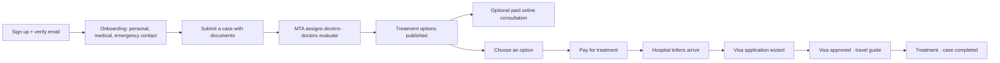

# Patient portal

Area: `/patient/**` · Code: `frontend/src/portals/patient/`, backend packages `patient`, `cases`, `documents`, `treatment`, `consultation`, `payment`, `visa`, `chat` · Languages: English and Chinese (switcher in the top bar).

## Navigation

Dashboard · Case Management · Messages · Documents · Treatment · Visa & Travel · Payments · Account & Settings — plus the notification bell and the sign-out button in the top bar.

## Journey

## Features

### Account
- **Sign-up** at `/register` with name, email and password; a 6-digit code verifies the email.
- **Onboarding wizard** (`/patient/profile/setup`) is required before anything else: personal details, medical background (history, allergies, medications, past surgeries), emergency contact.
- **Account & Settings:** edit the same details, profile photo, email/SMS notification preferences, saved cards, change password, delete account (type DELETE; 30-day grace period, then everything is erased).
- Forgot / reset password with an emailed code.

### Dashboard
Journey progress for the most recent case, the next action to take, quick actions, and case cards.

### Cases
- **New case** (3 steps): specialty, description of the condition (50–2000 characters), and documents (PDF/JPG/PNG, up to 10 MB each, up to 10 per case, each tagged with a type).
- **Case detail:** status, documents (add more until a plan exists), travel/stay/transport assistance flags, and a timeline built from the case's notifications.
- When a doctor requests more documents, the patient gets a notification ("Your doctor requested additional documents") and uploads them on the case; the doctor sees each request change to *Received*.

### Treatment options
Published options show the doctor, hospital, procedure, timeline, recovery, aftercare and a cost breakdown (doctor fees, hospital fees, itemised costs, specialists, MTA service fee). Choosing one confirms the treatment and creates the payment.

### Initial consultation
While a doctor evaluates the case, they propose up to three times for a Zoom consultation. The case page shows "Initial consultation with Dr …": pick a time, pay the AUD 200 fee, and join on Zoom (the button opens 15 minutes before). The doctor prepares the treatment plan after this conversation.

### Online consultations (follow-up)
Request one about an option → the doctor proposes up to three times (shown in the doctor's time zone, e.g. Sydney, plus the patient's own) → pick a time → pay the AUD 200 fee → the consultation is scheduled with a Zoom link (the join button opens 15 minutes before).

### Payments
Stripe Payment Element with saved cards (or a simulated Pay Now in development). Payment history with PDF invoices. Refunds issued by MTA show on the payment (*Partly refunded* / *Refunded*, the amount returned) with a credit note PDF per refund; the patient is notified, including any card processing fee kept.

### Visa & Travel
Once the treatment is paid and the hospital's invitation and appointment letters arrive (the hospital issues them in the hospital portal), the 8-step visa wizard collects personal, passport, travel, financial and companion details with document uploads; the API validates the whole form. Afterwards: application detail, lawyer document requests, approved-visa download and a travel guide.

### Documents
All medical and visa documents in one place; upload standalone documents and link them to a case later.

### Messages and notifications
- Support chat with the MTA coordinator (MTA opens the conversation; the patient can ask to reopen a closed one).
- Notifications arrive live (bell, toasts) and by email/SMS according to preferences.
